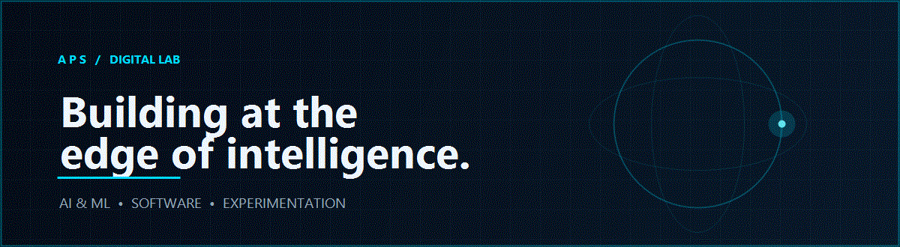



 

  

---

## `01` / THE PERSON BEHIND THE CODE

I'm a second-year **B.Tech Computer Science student specialising in Artificial Intelligence & Machine Learning** at **SRM Institute of Science and Technology**.

I enjoy exploring how software works, learning new technologies, and turning ideas into practical projects. Right now, I'm strengthening my programming and computer science fundamentals while experimenting with AI, machine learning, and web development.

- **Currently learning:** Data Structures, Object-Oriented Programming, AI & Machine Learning
- **Interested in:** Software development, intelligent systems, and cybersecurity
- **Approach:** Learn the fundamentals. Build small. Improve continuously.

## `02` / SELECTED BUILDS

<table>
<tr>
<td width="50%" valign="top">

### ◈ DeepFake Detection System

A Flask-based media inspection workspace for image and video analysis, with video-frame sampling and OpenCV-based face localisation.

**Focus:** Python · Flask · OpenCV

[Explore repository](https://github.com/abhinavprasadsingh/DeepFake-Detection-System) · [Open live workspace](https://deepfake-detection-system-zch2.onrender.com/)

</td>
<td width="50%" valign="top">

### ◈ PhishShield

A Python project for analysing URLs with explainable heuristic checks, alongside an optional scikit-learn model training and evaluation workflow.

**Focus:** Python · URL analysis · scikit-learn

[Explore repository](https://github.com/abhinavprasadsingh/PhishShield)

</td>
</tr>
<tr>
<td width="50%" valign="top">

### ◈ Personal Portfolio Website

A personal website project created to present my background, work, and development journey.

**Focus:** Web development

[Explore repository](https://github.com/abhinavprasadsingh/Personal-Portfolio-Website)

</td>
<td width="50%" valign="top">

### ◈ More experiments

I use my repositories to practise programming, explore new concepts, and document what I learn. More projects will appear here as they become ready.

**Focus:** Consistent learning · Hands-on practice

[Browse all repositories](https://github.com/abhinavprasadsingh?tab=repositories)

</td>
</tr>
</table>

## `03` / TECHNOLOGY I WORK WITH

My current toolkit reflects the languages and tools I have used or am actively learning—not a claim of expert-level proficiency.

## `04` / THE LEARNING LOG

- Building a stronger foundation in Data Structures and Object-Oriented Programming.
- Exploring practical applications of AI and Machine Learning.
- Improving how I design, document, and maintain software projects.

---

**Curiosity → Code → Experiments → Progress**

Designed and built with intention. Updated as the journey continues.

