

<picture>
  <source media="(prefers-color-scheme: light)" srcset="./assets/light/header.svg">
  
</picture>

<picture>
  <source media="(prefers-color-scheme: light)" srcset="./assets/light/typing.svg">
  
</picture>

<a href="https://github.com/abhinavprasadsingh">GitHub</a> &nbsp;&middot;&nbsp; <a href="https://linkedin.com/in/abhinav-p-416603377">LinkedIn</a>

<picture>
  <source media="(prefers-color-scheme: light)" srcset="./assets/light/section-about.svg">
  
</picture>

<picture>
  <source media="(prefers-color-scheme: light)" srcset="./assets/light/avatar.svg">
  
</picture>

I'm **Abhinav Prasad Singh**, a second-year B.Tech student in Computer Science and Engineering, specializing in Artificial Intelligence and Machine Learning at **SRM Institute of Science and Technology, Kattankulathur**. I expect to graduate in 2029.

I learn by building. My projects so far cover media analysis with computer vision, URL risk analysis, and web development, and I use them to strengthen my fundamentals in programming, data structures, and machine learning.

| Detail | Information |
|:--|:--|
| **Education** | B.Tech, Computer Science and Engineering (AI &amp; ML) |
| **Institution** | SRM Institute of Science and Technology, Kattankulathur |
| **Expected graduation** | 2029 |
| **Location** | India |

<picture>
  <source media="(prefers-color-scheme: light)" srcset="./assets/light/section-projects.svg">
  
</picture>

<picture>
  <source media="(prefers-color-scheme: light)" srcset="./assets/light/project-1.svg">
  
</picture>

[Repository &#8599;](https://github.com/abhinavprasadsingh/DeepFake-Detection-System) &nbsp;&middot;&nbsp; [Live workspace &#8599;](https://deepfake-detection-system-zch2.onrender.com/)

<picture>
  <source media="(prefers-color-scheme: light)" srcset="./assets/light/project-2.svg">
  
</picture>

[Repository &#8599;](https://github.com/abhinavprasadsingh/PhishShield)

<picture>
  <source media="(prefers-color-scheme: light)" srcset="./assets/light/project-3.svg">
  
</picture>

[Repository &#8599;](https://github.com/abhinavprasadsingh/Personal-Portfolio-Website)

<picture>
  <source media="(prefers-color-scheme: light)" srcset="https://raw.githubusercontent.com/abhinavprasadsingh/abhinavprasadsingh/output/light/projects-live.svg">
  
</picture>

<picture>
  <source media="(prefers-color-scheme: light)" srcset="./assets/light/section-toolkit.svg">
  
</picture>

<picture>
  <source media="(prefers-color-scheme: light)" srcset="./assets/light/toolkit.svg">
  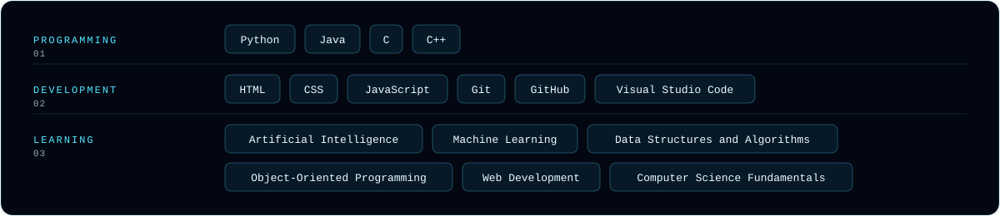
</picture>

<picture>
  <source media="(prefers-color-scheme: light)" srcset="./assets/light/section-matrix.svg">
  
</picture>

<picture>
  <source media="(prefers-color-scheme: light)" srcset="https://raw.githubusercontent.com/abhinavprasadsingh/abhinavprasadsingh/output/light/contribution-matrix.svg">
  
</picture>

<picture>
  <source media="(prefers-color-scheme: light)" srcset="https://raw.githubusercontent.com/abhinavprasadsingh/abhinavprasadsingh/output/light/stats.svg">
  
</picture>

<picture>
  <source media="(prefers-color-scheme: light)" srcset="https://raw.githubusercontent.com/abhinavprasadsingh/abhinavprasadsingh/output/light/activity.svg">
  
</picture>

The matrix, streaks, languages, repository stats and commit ticker are generated daily from my public GitHub data by a GitHub Actions workflow in this repository.

<picture>
  <source media="(prefers-color-scheme: light)" srcset="./assets/light/section-direction.svg">
  
</picture>

| Focus | Direction |
|:--|:--|
| **Learning** | Programming fundamentals, data structures and algorithms, object-oriented programming |
| **Building** | Practical software and AI/ML projects |
| **Exploring** | Artificial intelligence, machine learning, and web development |
| **Improving** | Writing cleaner, more reliable code |

<picture>
  <source media="(prefers-color-scheme: light)" srcset="./assets/light/footer.svg">
  
</picture>
