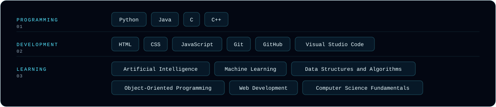

<a href="https://github.com/abhinavprasadsingh">GitHub</a> &nbsp;&middot;&nbsp; <a href="https://linkedin.com/in/abhinav-p-416603377">LinkedIn</a>

I'm **Abhinav Prasad Singh**, a second-year B.Tech student in Computer Science and Engineering, specializing in Artificial Intelligence and Machine Learning at **SRM Institute of Science and Technology, Kattankulathur**. I expect to graduate in 2029.

I learn by building. My projects so far cover media analysis with computer vision, URL risk analysis, and web development, and I use them to strengthen my fundamentals in programming, data structures, and machine learning.

| | |
|:--|:--|
| **Education** | B.Tech, Computer Science and Engineering (AI &amp; ML) |
| **Institution** | SRM Institute of Science and Technology, Kattankulathur |
| **Expected graduation** | 2029 |
| **Location** | India |

[Repository &#8599;](https://github.com/abhinavprasadsingh/DeepFake-Detection-System) &nbsp;&middot;&nbsp; [Live workspace &#8599;](https://deepfake-detection-system-zch2.onrender.com/)

[Repository &#8599;](https://github.com/abhinavprasadsingh/PhishShield)

[Repository &#8599;](https://github.com/abhinavprasadsingh/Personal-Portfolio-Website)

Generated daily from my GitHub contribution calendar by a GitHub Actions workflow in this repository.

| Focus | Direction |
|:--|:--|
| **Learning** | Programming fundamentals, data structures and algorithms, object-oriented programming |
| **Building** | Practical software and AI/ML projects |
| **Exploring** | Artificial intelligence, machine learning, and web development |
| **Improving** | Writing cleaner, more reliable code |

